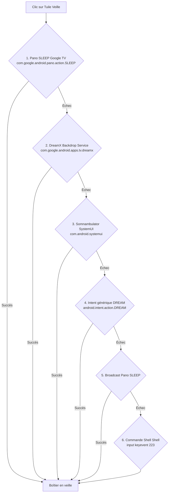

# 📺 jd tv — Documentation Technique & Guide d'Utilisation

> **Nom officiel** : **jd tv** (anciennement *Zen TV* / *Minimal TV Launcher*)  
> **Version actuelle** : **0.9** (`versionCode = 9`, `versionName = "0.9"`)  
> **Cible matérielle** : Chromecast with Google TV 4K (Nom de code : `sabrina`, SoC Amlogic, Android 14+)  
> **Contrainte critique absolue** : **2 Go de RAM physique seulement** — Empreinte mémoire launcher **≤ 30 Mo de RAM**, **60 FPS constants**, 0 framework lourd.

---

## Sommaire

1. [Architecture Technique & Philosophie Minimaliste](#1-architecture-technique--philosophie-minimaliste)
   - [1.1 Cible matérielle & Contraintes physiques](#11-cible-matérielle--contraintes-physiques)
   - [1.2 Empreinte mémoire et budget RAM strict (< 30 Mo)](#12-empreinte-mémoire-et-budget-ram-strict--30-mo)
   - [1.3 Stack 100% Android Views natif](#13-stack-100-android-views-natif)
   - [1.4 Composants clés du système](#14-composants-clés-du-système)
2. [Guide Utilisateur de la Télécommande D-Pad](#2-guide-utilisateur-de-la-télécommande-d-pad)
   - [2.1 Anatomie de la télécommande et navigation](#21-anatomie-de-la-télécommande-et-navigation)
   - [2.2 Le Dock d'accueil (5 applications favorites)](#22-le-dock-daccueil-5-applications-favorites)
   - [2.3 Le Tiroir complet d'applications (All-Apps Drawer)](#23-le-tiroir-complet-dapplications-all-apps-drawer)
   - [2.4 Accès aux widgets d'en-tête et Centre de Contrôle](#24-accès-aux-widgets-den-tête-et-centre-de-contrôle)
   - [2.5 Gestion de la touche Retour (Back)](#25-gestion-de-la-touche-retour-back)
   - [2.6 Actions au Clic Long (Menu contextuel Leanback)](#26-actions-au-clic-long-menu-contextuel-leanback)
3. [Centre de Contrôle tvOS 2x2 & Réglages Système](#3-centre-de-contrôle-tvos-2x2--réglages-système)
   - [3.1 Présentation et ouverture du panneau latéral](#31-présentation-et-ouverture-du-panneau-latéral)
   - [3.2 Option Éteindre TV (HDMI-CEC Standby Physique)](#32-option-éteindre-tv-hdmi-cec-standby-physique)
   - [3.3 Option Veille Daydream Native Google TV](#33-option-veille-daydream-native-google-tv)
   - [3.4 Statut Wi-Fi Précis : 'Connecté • [nom]'](#34-statut-wi-fi-précis--connecté--nom)
   - [3.5 Niveau de Batterie Télécommande / Manette en Pourcentage 'XX%'](#35-niveau-de-batterie-télécommande--manette-en-pourcentage-xx)
   - [3.6 Options de Thèmes (Sombre LED, OLED Pur, Bing 4K)](#36-options-de-thèmes-sombre-led-oled-pur-bing-4k)
   - [3.7 Protection d'écran OLED & Normes d'Accessibilité WCAG](#37-protection-décran-oled--normes-daccessibilité-wcag)
4. [Dashboard Bureau & Widgets de l'Écran d'Accueil](#4-dashboard-bureau--widgets-de-lécran-daccueil)
   - [4.1 Disposition de la Colonne Latérale Droite](#41-disposition-de-la-colonne-latérale-droite)
   - [4.2 Carte Carrée Actualités Google News (170×170dp, Haut)](#42-carte-carrée-actualités-google-news-170170dp-haut)
   - [4.3 Carte Carrée Sport en Direct (170×170dp, Bas)](#43-carte-carrée-sport-en-direct-170170dp-bas)
   - [4.4 Écussons Sportifs Officiels Vectoriels Wikipédia/Wikimedia](#44-écussons-sportifs-officiels-vectoriels-wikipédiawikimedia)
   - [4.5 Retrait du Widget Wi-Fi de l'Accueil](#45-retrait-du-widget-wi-fi-de-laccueil)
   - [4.6 Capsules d'En-tête (Horloge, RAM Libre, Météo Locale)](#46-capsules-den-tête-horloge-ram-libre-météo-locale)
5. [Moteur de Recherche de Contenu Universel](#5-moteur-de-recherche-de-contenu-universel)
   - [5.1 Présentation & Référence d'Architecture](#51-présentation--référence-darchitecture)
   - [5.2 Principes Clés : Zéro Lag, Cache < 5 Mo, Deep Linking](#52-principes-clés--zéro-lag-cache--5-mo-deep-linking)
6. [Procédure de Déploiement ADB & Guide de Debloat](#6-procédure-de-déploiement-adb--guide-de-debloat)
   - [6.1 Préparation et connexion ADB (USB & Wi-Fi)](#61-préparation-et-connexion-adb-usb--wi-fi)
   - [6.2 Compilation et installation de jd tv v0.9](#62-compilation-et-installation-de-jd-tv-v09)
   - [6.3 Définition de jd tv comme Launcher par Défaut](#63-définition-de-jd-tv-comme-launcher-par-défaut)
   - [6.4 Commandes de Debloat des Bloatwares Google TV](#64-commandes-de-debloat-des-bloatwares-google-tv)
   - [6.5 Scripts Batch Clé-en-main d'Optimisation et Restauration](#65-scripts-batch-clé-en-main-doptimisation-et-restauration)
7. [Instructions de Maintenance & Commandes pour Google Jules](#7-instructions-de-maintenance--commandes-pour-google-jules)
   - [7.1 Commandes de validation obligatoires](#71-commandes-de-validation-obligatoires)
   - [7.2 Les 4 Tâches Automatisées de Jules](#72-les-4-tâches-automatisées-de-jules)

---

## 1. Architecture Technique & Philosophie Minimaliste

### 1.1 Cible matérielle & Contraintes physiques

Le launcher **`jd tv`** (identifié par l'identifiant d'application `com.minimal.tvlauncher`) est conçu spécifiquement pour adresser les lacunes critiques d'ergonomie et de lenteur du launcher Google TV officiel sur les clés et boîtiers TV compacts :
* **Appareil de référence** : Chromecast with Google TV 4K (Nom de code : `sabrina`, processeur Amlogic S905X4 quad-core ARM Cortex-A55, GPU Mali-G31 MP2).
* **Mémoire vive physique** : **2 Go de RAM physique seulement**, partagée entre le système d'exploitation Android 14+, les pilotes graphiques, les codecs matériels et les tampons d'affichage vidéo 4K.
* **Système d'exploitation supporté** : Android 14 (API 34) et versions supérieures, tout en assurant une rétrocompatibilité descendante jusqu'à Android 8.0 Oreo (API 26).

Sur ces boîtiers, le launcher officiel Google TV (`com.google.android.apps.tv.launcherx`) consomme entre 180 et 280 Mo de mémoire vive à lui seul en raison des multiples requêtes de profilage publicitaire et carrousels de bandes-annonces en arrière-plan. Cela conduit inévitablement au ralentissement (stutter) de l'interface et à l'expulsion intempestive (OOM Kill) des applications multimédias exigeantes (Kodi, Plex, Jellyfin, Tivimate).

### 1.2 Empreinte mémoire et budget RAM strict (< 30 Mo)

L'engagement fondamental de **`jd tv`** repose sur une frugalité algorithmique stricte :
* **Plafond mémoire maximal en croisière** : **≤ 30 Mo de RAM**.
* **Fluidité d'affichage** : **60 FPS constants** sans saccade (jank), y compris lors du défilement des listes ou du glissement du Centre de Contrôle.
* **Absence totale de fuite mémoire** : Cycle de vie hermétique, interdiction des références statiques vers des objets `Context` ou `Activity`, utilisation systématique de `context.applicationContext`.
* **Compression Bitmap RGB_565** : Les images d'affiches et vignettes Top Shelf sont sous-échantillonnées (`inSampleSize`) et décodées en configuration `Bitmap.Config.RGB_565` (16 bits par pixel au lieu de 32 bits ARGB_8888), diminuant l'empreinte mémoire des textures de 50%.
* **Cache mémoire LRU strictement plafonné** : Le cache mémoire d'images est verrouillé à un maximum absolu de 4 Mo (`TopShelfManager.MAX_POSTER_CACHE_BYTES`).

### 1.3 Stack 100% Android Views natif

Afin de respecter la limite des 2 Go de RAM sans compromis de réactivité :
* **Interdiction formelle des frameworks lourds** : Pas de Jetpack Compose, pas de Flutter, pas de React Native, pas de Dagger/Hilt, pas d'ORM Room.
* **Android Views classiques ultra-légères** :
  - `RecyclerView` avec recyclage granulaire des cartes d'applications (`AppCardAdapter`).
  - `CardView` et `FrameLayout` optimisés.
  - Transitions matérielles exécutées par `ViewPropertyAnimator` avec interpolateurs légers (`DecelerateInterpolator`, `OvershootInterpolator`).
  - View Binding Android officiel (`buildFeatures { viewBinding = true }`).
* **Dépendances de production épurées** :
  - `androidx.core:core-ktx:1.12.0`
  - `androidx.appcompat:appcompat:1.6.1`
  - `androidx.recyclerview:recyclerview:1.3.2`
  - `androidx.cardview:cardview:1.0.0`

### 1.4 Composants clés du système

```
                          ┌────────────────────────┐
                          │      MainActivity      │
                          │   (Orchestrateur UI)   │
                          └───────────┬────────────┘
                                      │
       ┌──────────────┬───────────────┼───────────────┬──────────────┐
       │              │               │               │              │
┌──────▼──────┐┌──────▼──────┐┌───────▼───────┐┌──────▼──────┐┌──────▼──────┐
│TopShelfMgr  ││DisplayResMgr││ SportsManager ││ NewsManager ││BluetoothMgr │
│(Leanback EPG││(HDMI-CEC,   ││(Scores live & ││(Google News ││(Manette &   │
│ & Curated)  ││ 4K, Veille) ││ 12 Écussons)  ││ RSS stream) ││  Batterie)  │
└─────────────┘└─────────────┘└───────────────┘└─────────────┘└─────────────┘
                                      │
                          ┌───────────▼────────────┐
                          │   PreferencesManager   │
                          │(SharedPreferences/JSON)│
                          └────────────────────────┘
```

1. **[`MainActivity`](file:///c:/Users/jdgen/OneDrive/Documents/android%20tv%20apple%20tv/app/src/main/java/com/minimal/tvlauncher/MainActivity.kt)** :
   Chef d'orchestre de l'interface, gestionnaire du cycle de vie Android TV (`singleTask`, `stateNotNeeded="true"`), écouteur d'évènements de paquets (`PACKAGE_ADDED`, `PACKAGE_REMOVED`), et régulateur de la navigation D-Pad.
2. **[`TopShelfManager`](file:///c:/Users/jdgen/OneDrive/Documents/android%20tv%20apple%20tv/app/src/main/java/com/minimal/tvlauncher/manager/TopShelfManager.kt)** :
   Interroge le fournisseur de contenus Android TV standard `TvContract` (`content://android.media.tv/watch_next_program` et `content://android.media.tv/preview_program`), avec repli immersif 4K haute fidélité pour les plateformes majeures (Netflix, Prime Video, Crave, YouTube, Spotify, Twitch, VLC).
3. **[`DisplayResolutionManager`](file:///c:/Users/jdgen/OneDrive/Documents/android%20tv%20apple%20tv/app/src/main/java/com/minimal/tvlauncher/manager/DisplayResolutionManager.kt)** :
   Gère la détection de la résolution réelle (4K UHD 3840×2160, 1080p), de la fréquence de rafraîchissement HDMI, du calibrage de l'overscan, du statut Wi-Fi formaté (`Connecté • [nom]`), de la veille logicielle Daydream et de **l'extinction physique du téléviseur par commande HDMI-CEC opcode `0x36`**.
4. **[`SportsManager`](file:///c:/Users/jdgen/OneDrive/Documents/android%20tv%20apple%20tv/app/src/main/java/com/minimal/tvlauncher/manager/SportsManager.kt)** :
   Récupère en temps réel les scores sportifs sans clé d'API (requêtes HTTPS légères ESPN) et associe automatiquement les **12 écussons vectoriels officiels intégrés** (Canadiens, Maple Leafs, Bruins, Rangers, Oilers, Lakers, Celtics, Warriors, Raptors, Real Madrid, Barcelone, PSG).
5. **[`NewsManager`](file:///c:/Users/jdgen/OneDrive/Documents/android%20tv%20apple%20tv/app/src/main/java/com/minimal/tvlauncher/manager/NewsManager.kt)** :
   Analyseur RSS Google News ultra-léger basé sur `XmlPullParser` alimentant la carte Actualités carrée (170×170dp).
6. **[`BluetoothDeviceManager`](file:///c:/Users/jdgen/OneDrive/Documents/android%20tv%20apple%20tv/app/src/main/java/com/minimal/tvlauncher/manager/BluetoothDeviceManager.kt)** :
   Détecte les périphériques de contrôle (télécommande vocale Google TV, manettes Bluetooth Xbox/PlayStation/Shield), lit leur niveau de batterie précis en pourcentage et active l'indicateur d'alerte critique si ≤ 20%.
7. **[`PreferencesManager`](file:///c:/Users/jdgen/OneDrive/Documents/android%20tv%20apple%20tv/app/src/main/java/com/minimal/tvlauncher/manager/PreferencesManager.kt)** :
   Gestionnaire de persistance thread-safe basé sur `SharedPreferences` avec écritures asynchrones (`apply()`) et gestion d'erreurs robuste pour l'ordre des favoris, les widgets et les applications masquées.

---

## 2. Guide Utilisateur de la Télécommande D-Pad

Le launcher **jd tv** offre une navigation 100% pensée pour la télécommande infrarouge et Bluetooth des téléviseurs et boîtiers TV.

```
                  ┌───────────────────────┐
                  │    [ HAUT ]           │ ───> Accès Direct : Centre de Contrôle
                  │                       │      & Réglages en-tête (depuis le Dock)
    Navigation    │ [GAUCHE] [OK] [DROITE]│ ───> Défilement des Apps & Lancement (OK)
     du D-Pad     │                       │      Clic Long OK : Menu contextuel
                  │    [ BAS ]            │ ───> Ouverture du Tiroir complet (All-Apps)
                  └───────────────────────┘
                                │
                        [ RETOUR / BACK ]  ───> Ferme le Tiroir / Centre de Contrôle
                                                Retour immédiat au Dock (anti-quitter)
```

### 2.1 Anatomie de la télécommande et navigation

* **Flèches Gauche / Droite** : Déplacement horizontal fluide entre les cartes d'applications.
* **Flèche Bas** :
  - *Depuis le Dock d'accueil* : Ouvre instantanément le **Tiroir complet d'applications** (All-Apps Drawer) en animant le Dock vers le bas.
  - *Dans le Tiroir d'applications* : Fait défiler les rangées suivantes d'applications vers le bas.
* **Flèche Haut** :
  - *Depuis le Dock d'accueil* : Déplace directement le focus vers le bouton du **Centre de Contrôle & Réglages** (`btn_settings`) en haut à droite.
  - *Dans le Tiroir d'applications* : Depuis la première rangée (éléments 0 à 4), presser Haut referme le tiroir et replace instantanément le focus sur l'application active du Dock.
* **Bouton Central Sélection / OK** :
  - **Pression brève** : Lance immédiatement l'application sélectionnée.
  - **Pression longue (> 500 ms)** : Ouvre le menu contextuel Leanback de gestion d'application.

### 2.2 Le Dock d'accueil (5 applications favorites)

Au repos, l'écran d'accueil présente un Dock épuré inspiré de tvOS contenant vos **5 applications favorites** :
* Les vignettes adoptent des proportions cinématographiques 16:9 (`item_app_card`).
* **Effet de survol immersif** : Lorsqu'une application du Dock reçoit le focus, elle s'agrandit avec une animation d'élasticité (échelle 1.08x, élévation 14dp, halo lumineux blanc) et l'arrière-plan affiche en fondu la recommandation Top Shelf associée.
* **Zéro focus trap** : Le focus circule librement d'un bout à l'autre sans blocage.

### 2.3 Le Tiroir complet d'applications (All-Apps Drawer)

Pour consulter la totalité des applications installées sur le Chromecast :
1. Depuis le Dock, appuyez sur la flèche **Bas**.
2. Le tiroir complet se déploie dans une grille ergonomique à 5 colonnes.
3. Le défilement est optimisé par recyclage de vues et conserve une cadence inébranlable de 60 Hz.
4. Pour refermer le tiroir, appuyez sur **Retour** ou remontez sur la première rangée et faites **Haut**.

### 2.4 Accès aux widgets d'en-tête et Centre de Contrôle

Depuis le Dock d'accueil, appuyez sur la flèche **Haut** pour sélectionner la capsule d'accès rapide aux réglages (`btn_settings`) :
* L'icône de roue crantée s'illumine et grossit subtilement (échelle 1.25x).
* Une pression sur **OK** déploie immédiatement le **Centre de Contrôle tvOS**.
* Pour revenir au Dock sans ouvrir le volet, faites simplement **Bas**.

### 2.5 Gestion de la touche Retour (Back)

La touche **Retour** (`KEYCODE_BACK`) applique un comportement défensif pour éviter toute interruption inopinée :
* **Si le Centre de Contrôle est ouvert** : La touche Retour le referme immédiatement et restitue le focus sur la roue crantée.
* **Si le Tiroir complet est ouvert** : La touche Retour le referme en douceur et restitue le focus sur le Dock.
* **Si vous êtes sur le Dock d'accueil** : La touche Retour est consommée sans quitter le launcher. Le boîtier ne bascule jamais sur un écran noir.

### 2.6 Actions au Clic Long (Menu contextuel Leanback)

En maintenant enfoncé le bouton central **OK** sur une vignette d'application, un menu contextuel s'affiche :
1. **Ajouter aux favoris / Retirer des favoris** : Épingle l'application sur le Dock ou la renvoie dans le tiroir.
2. **Masquer l'application** : Dissimule l'application de la grille (idéal pour purger les services système et bloatwares résiduels).
3. **Détails de l'application** : Ouvre les paramètres système Android TV pour vider le cache ou désinstaller l'application.

---

## 3. Centre de Contrôle tvOS 2x2 & Réglages Système

Le **Centre de Contrôle** de `jd tv` reproduit fidèlement le volet latéral translucide moderne d'Apple TV, structuré en une grille 2x2 optimisée pour l'alimentation et la connectivité.

```
┌─────────────────────────────────────────────────────────────┐
│                      Écran d'Accueil                        │
│                                           ┌───────────────┐ │
│                                           │Centre Contrôle│ │
│                                           ├───────────────┤ │
│                                           │[Veille][WiFi  │ │
│                                           │Direct] Connect│ │
│                                           │[Éteint][Manet]│ │
│                                           │TV-CEC] 85% [!]│ │
│                                           │  (O)  (♿) (X) │ │
│                                           └───────────────┘ │
└─────────────────────────────────────────────────────────────┘
```

### 3.1 Présentation et ouverture du panneau latéral

* **Déploiement fluide** : Le volet (largeur 360dp) coulisse depuis la droite de l'écran avec une translation sur l'axe X (420px -> 0px) et un assombrissement d'arrière-plan en 240 ms.
* **Verrouillage modal du focus (Anti-Focus Leak)** : Dès l'ouverture, les `RecyclerView` de l'accueil sont verrouillées (`FOCUS_BLOCK_DESCENDANTS`). Le focus de la télécommande est capturé à l'intérieur du volet.
* Le focus initial est automatiquement positionné sur le bouton de **Veille**.

### 3.2 Option Éteindre TV (HDMI-CEC Standby Physique)

Le bouton **« Éteindre TV »** (`btn_cc_cec_power`), illustré par une icône d'écran de télévision, permet d'**éteindre physiquement le téléviseur connecté en HDMI** sans avoir à chercher la télécommande d'origine de la marque de votre télévision (LG, Samsung, Sony, Philips, TCL).

#### Mécanisme technique d'extinction HDMI-CEC :
1. **Opcode CEC `0x36` (`STANDBY`)** :
   `DisplayResolutionManager.sendTvCecStandbyDirect()` utilise l'accès par réflexion sécurisée au service système `HdmiControlManager` d'Android TV.
2. **Client HDMI Playback** :
   Le gestionnaire obtient l'instance de `HdmiPlaybackClient` (ou `HdmiTvClient`) et invoque la méthode `sendStandby()`. Cette commande envoie la trame CEC normalisée `0x36` sur la broche 13 du câble HDMI, signalant au téléviseur de passer en veille matérielle complète.
3. **Diffusion Broadcast de Sécurité** :
   En cas d'implémentation propriétaire du constructeur bloquant la réflexion, un broadcast explicite `android.hardware.hdmi.action.STANDBY` est émis par le système.

```kotlin
// Extrait de DisplayResolutionManager.kt
val hdmiManager = context.getSystemService("hdmi_control")
val client = getPlaybackClientMethod.invoke(hdmiManager)
val sendStandbyMethod = client.javaClass.getMethod("sendStandby")
sendStandbyMethod.invoke(client) // Envoi CEC opcode 0x36
```

### 3.3 Option Veille Daydream Native Google TV

Le bouton **« Veille »** (`btn_cc_power`) active la mise en sommeil logicielle du boîtier Google TV via une chaîne de repli défensive à 6 niveaux orchestrée par `DisplayResolutionManager` :



### 3.4 Statut Wi-Fi Précis : 'Connecté • [nom]'

La tuile réseau (`btn_cc_wifi`) affiche l'état exact de votre connectivité Internet :
* **Format dynamique** : `Connecté • [nom]` (ex : `Connecté • MonWiFi_5G`).
* **Prise en charge Ethernet** : Affiche automatiquement `Connecté • Ethernet` si un câble réseau RJ45 est branché.
* **État déconnecté** : Affiche `Non connecté` en cas de coupure de signal.
* **Clic direct** : Ouvre immédiatement la page des paramètres sans fil d'Android TV (`Settings.ACTION_WIFI_SETTINGS`).

### 3.5 Niveau de Batterie Télécommande / Manette en Pourcentage 'XX%'

La tuile accessoire (`btn_cc_remote_battery`) interroge les périphériques d'entrée Bluetooth connectés via `BluetoothDeviceManager` :
* **Niveau de charge en pourcentage** : Affiche la batterie restante au format `XX%` (ex : `85%`, `100%`) interrogée via `InputDevice.getBatteryState()` (Android 12+ / API 31+).
* **Statut de secours** : Affiche `Connectée` si le périphérique ne transmet pas de télémétrie de charge.
* **Pastille rouge d'alerte critique `[!]`** : Si le niveau de batterie descend à **20% ou moins**, une pastille d'alerte rouge vif avec point d'exclamation s'affiche automatiquement pour prévenir l'utilisateur avant l'extinction de la télécommande.
* **Clic direct** : Ouvre les paramètres d'accessoires Bluetooth d'Android TV.

### 3.6 Options de Thèmes (Sombre LED, OLED Pur, Bing 4K)

Depuis le bouton des réglages (`btn_cc_all_settings`) :
1. **Sombre Standard LED (`#0E1420`)** : Teinte bleu nuit apaisante conçue pour les dalles LCD/LED.
2. **Sombre Pur OLED (`#000000`)** : Extinction complète des sous-pixels noirs sur écrans OLED, réduisant la consommation électrique et maximisant le contraste.
3. **Fond d'écran Bing 4K Quotidien** : Récupération quotidienne de l'image Bing 4K avec mise en cache locale.
4. **Fonds d'écran personnalisés** : Sélection d'images enregistrées localement sur le stockage du boîtier.

### 3.7 Protection d'écran OLED & Normes d'Accessibilité WCAG

* **Mode Contraste Élevé 7:1** : Bordure dorée lumineuse (`#FFD600` de 3dp) autour des éléments sélectionnés sur fond noir absolu, dépassant les exigences WCAG 2.1 AAA.
* **Rétroaction sonore D-Pad** : Clics sonores système à chaque déplacement.
* **Descriptions TalkBack complètes** : Tous les boutons interactifs possèdent des `contentDescription` explicites.
* **Protection anti-brûlure OLED** :
  - *Pixel Shift* : Déplacement imperceptible (1 à 2 px toutes les 5 minutes) des conteneurs statiques.
  - *HUD Dimming* : Réduction de luminosité de -30% après 2 minutes d'inactivité.
  - *Veille automatique rapide* : Mise en veille après 3 minutes d'inactivité sur l'écran d'accueil.

---

## 4. Dashboard Bureau & Widgets de l'Écran d'Accueil

### 4.1 Disposition de la Colonne Latérale Droite

L'écran d'accueil de `jd tv` intègre un tableau de bord latéral droit (`dashboard_widgets_column`) qui organise les informations contextuelles de manière élégante et hiérarchisée, sans jamais masquer le fond d'écran ni surcharger l'espace visuel :

```
┌─────────────────────────────────────────────────────────────┐
│ 14:30  Lundi 26 Octobre                [RAM: 1.2G] [☀️ 21°C] │
│                                           ┌───────────────┐ │
│                                           │ 📰 Actualités │ │
│                                           │ Découverte    │ │
│                                           │ spatiale...   │ │
│                                           │  Radio-Canada │ │
│                                           ├───────────────┤ │
│                                           │ 🏒 LNH        │ │
│                                           │ [MTL] 3 2[TOR]│ │
│                                           │    3e Pér.    │ │
│                                           └───────────────┘ │
│                                                             │
│      ┌────────────────────────────────────────────────┐     │
│      │ [App 1]   [App 2]   [App 3]   [App 4]   [App 5]│     │
│      └────────────────────────────────────────────────┘     │
└─────────────────────────────────────────────────────────────┘
```

### 4.2 Carte Carrée Actualités Google News (170×170dp, Haut)

* **Positionnement** : Située **tout en haut** de la colonne latérale droite (`widget_news_container`), directement au-dessus de la carte Sport.
* **Composant UI** : `view_news_card.xml` (dimensions 170dp × 170dp, coins arrondis givrés de 20dp).
* **Affichage** :
  - Badge supérieur : `📰 Actualités` et tag `Direct`.
  - Titre de l'actualité centré : Police nette 13sp limitant l'encombrement à 3 lignes avec ellipse.
  - Source journalistique en bas à droite : ex: `Radio-Canada`, `La Presse`, `Le Monde`.
* **Performances** : Analyseur RSS basé sur `XmlPullParser` natif, non-capturant pour le D-Pad (`descendantFocusability="blocksDescendants"`).

### 4.3 Carte Carrée Sport en Direct (170×170dp, Bas)

* **Positionnement** : Située **juste en dessous** de la carte d'actualités (`widget_sports_container`).
* **Composant UI** : `view_sports_card.xml` (dimensions 170dp × 170dp, coins arrondis 20dp).
* **Affichage** :
  - Badge de la ligue : `🏒 LNH`, `🏀 NBA`, `🏈 NFL`, `⚽ Foot`, `⚾ MLB`.
  - Écussons vectoriels haute définition des deux équipes qui s'affrontent.
  - Score en direct en gros caractères gras (18sp) et statut de la rencontre (`1ère Pér.`, `Mi-temps`, `Final`).
  - Priorisation automatique des matchs de votre équipe favorite configurée dans les réglages.

### 4.4 Écussons Sportifs Officiels Vectoriels Wikipédia/Wikimedia

Afin de garantir un affichage cristallin sans flou sur écran 4K et sans aucune requête réseau supplémentaire, **12 écussons vectoriels officiels légers (< 3 Ko chacun)** issus des tracés vectoriels Wikipédia/Wikimedia sont intégrés au paquet APK :

| Discipline | Équipe | Fichier Ressource Vectoriel |
| :--- | :--- | :--- |
| **LNH (Hockey)** | **Canadiens de Montréal** | `R.drawable.ic_team_canadiens` |
| **LNH (Hockey)** | **Toronto Maple Leafs** | `R.drawable.ic_team_leafs` |
| **LNH (Hockey)** | **Boston Bruins** | `R.drawable.ic_team_bruins` |
| **LNH (Hockey)** | **New York Rangers** | `R.drawable.ic_team_rangers` |
| **LNH (Hockey)** | **Edmonton Oilers** | `R.drawable.ic_team_oilers` |
| **NBA (Basketball)** | **Los Angeles Lakers** | `R.drawable.ic_team_lakers` |
| **NBA (Basketball)** | **Boston Celtics** | `R.drawable.ic_team_celtics` |
| **NBA (Basketball)** | **Golden State Warriors** | `R.drawable.ic_team_warriors` |
| **NBA (Basketball)** | **Toronto Raptors** | `R.drawable.ic_team_raptors` |
| **Soccer Européen** | **Real Madrid** | `R.drawable.ic_team_real_madrid` |
| **Soccer Européen** | **FC Barcelone** | `R.drawable.ic_team_barcelona` |
| **Soccer Européen** | **Paris Saint-Germain (PSG)** | `R.drawable.ic_team_psg` |
| **Multisport** | **Écusson Générique** | `R.drawable.ic_team_generic` |

### 4.5 Retrait du Widget Wi-Fi de l'Accueil

Pour préserver la pureté visuelle du bandeau supérieur :
* Le widget Wi-Fi a été **retiré du sélecteur de widgets de l'accueil**.
* La surveillance réseau est **centralisée exclusivement dans le Centre de Contrôle**, évitant les redondances tout en offrant un statut précis `Connecté • [nom]`.

### 4.6 Capsules d'En-tête (Horloge, RAM Libre, Météo Locale)

* **Horloge & Date** : `TextClock` grand format (34sp) avec date complète en français.
* **Capsule RAM Libre** : Affichage en temps réel de la mémoire disponible (`RAM: 1.2G libre`) via `ActivityManager.MemoryInfo`.
* **Capsule Météo Locale** : Affichage température et icône (`Montréal • 21°C ☀️`) via l'API publique Open-Meteo strictly over HTTPS (zéro clé API requise, respect absolu de la vie privée).

---

## 5. Moteur de Recherche de Contenu Universel

### 5.1 Présentation & Référence d'Architecture

Dans la continuité de sa vision d'expérience tvOS épurée sur Google TV, le projet **`jd tv`** formalise son plan de développement d'un moteur de recherche de contenu universel.

> [!NOTE]
> Le plan technique exhaustif, les diagrammes de séquence et le routage des schémas d'URI sont consultables dans le fichier d'architecture dédié :  
> 👉 [**`docs/content-search-plan.md`**](file:///c:/Users/jdgen/OneDrive/Documents/android%20tv%20apple%20tv/docs/content-search-plan.md).

### 5.2 Principes Clés : Zéro Lag, Cache < 5 Mo, Deep Linking

1. **Latence de frappe ultra-faible (< 80 ms)** :
   Algorithme de debouncing à 250 ms adapté au D-Pad et à la saisie vocale par microphone pour ne pas saturer le SoC Amlogic.
2. **Budget RAM plafonné à < 5 Mo** :
   Cache mémoire LRU borné à 100 requêtes récentes, vignettes décodées en `RGB_565` et recyclage immédiat dans le `RecyclerView`.
3. **Agrégation multi-sources** :
   Interrogation conjointe du ContentProvider standard Android TV (`content://android.media.tv/preview_program`), du catalogue d'applications installées et de métadonnées légères TMDB/JustWatch en repli.
4. **Deep Linking direct multi-plateformes** :
   Lancement immédiat de la lecture vidéo sur les applications cibles :
   - **Netflix** : `http://www.netflix.com/watch/$id`
   - **Amazon Prime Video** : `https://app.primevideo.com/detail?gti=$gti`
   - **YouTube** : `https://www.youtube.com/watch?v=$id`
   - **Disney+** : `disneyplus://play?contentId=$id`
   - **Crave** : `https://www.crave.ca/en/search/$query`
   - **Apple TV** : `https://tv.apple.com/movie/$id`

---

## 6. Procédure de Déploiement ADB & Guide de Debloat

### 6.1 Préparation et connexion ADB (USB & Wi-Fi)

1. **Activer le mode Développeur sur le Chromecast** :
   - `Paramètres` > `Système` > `À propos`.
   - Cliquez 7 fois d'affilée sur `Build du système d'exploitation Android TV`.
2. **Activer le Débogage** :
   - `Paramètres` > `Système` > `Options pour les développeurs`.
   - Activez `Débogage USB` et `Débogage sans fil`.
3. **Connexion ADB depuis votre PC** :
   ```bash
   adb connect 192.168.2.100:5555
   adb devices
   ```

### 6.2 Compilation et installation de jd tv v0.9

```bash
# 1. Compilation de l'APK Release optimisé par R8
./gradlew assembleRelease

# 2. Installation directe sur le Chromecast
adb install -r app/build/outputs/apk/release/app-release.apk

# 3. Lancement immédiat de jd tv
adb shell am start -n com.minimal.tvlauncher/.MainActivity
```

### 6.3 Définition de jd tv comme Launcher par Défaut

Pour que **`jd tv`** s'ouvre automatiquement au démarrage et lors de l'appui sur la touche Maison (Home) de la télécommande :

```bash
adb shell cmd package set-home-activity com.minimal.tvlauncher/.MainActivity
```

### 6.4 Commandes de Debloat des Bloatwares Google TV

Pour libérer plus de 350 Mo de RAM physique sur le Chromecast et éliminer les publicités invasives de l'interface Google TV, exécutez les commandes de désactivation suivantes :

```bash
# 1. Désactivation du launcher commercial saturé de bannières publicitaires
adb shell pm disable-user --user 0 com.google.android.apps.tv.launcherx

# 2. Désactivation du catalogue payant Google TV Films / Store
adb shell pm disable-user --user 0 com.google.android.videos

# 3. Désactivation des recommandations d'annonces en tâche de fond
adb shell pm disable-user --user 0 com.google.android.tvrecommendations

# 4. Désactivation du suivi publicitaire AdServices
adb shell pm disable-user --user 0 com.google.android.adservices.api
adb shell pm disable-user --user 0 com.google.android.ext.adservices.api

# 5. Désactivation du profilage local et de la télémétrie
adb shell pm disable-user --user 0 com.google.android.ondevicepersonalization.services
adb shell pm disable-user --user 0 com.google.android.federatedcompute
adb shell pm disable-user --user 0 com.google.android.apps.tv.netoscope
```

#### Commandes de réactivation en cas de besoin :
Si vous souhaitez réactiver ultérieurement l'interface Google TV d'origine :
```bash
adb shell pm enable com.google.android.apps.tv.launcherx
adb shell pm enable com.google.android.videos
```

### 6.5 Scripts Batch Clé-en-main d'Optimisation et Restauration

Deux scripts prêts à l'emploi sont mis à disposition à la racine du dépôt :
* **[`optimize-chromecast.bat`](file:///c:/Users/jdgen/OneDrive/Documents/android%20tv%20apple%20tv/optimize-chromecast.bat)** :
  Désactive en une seule commande l'ensemble des bloatwares, applique les optimisations d'arrière-plan et lance jd tv.
* **[`restore-google-tv.bat`](file:///c:/Users/jdgen/OneDrive/Documents/android%20tv%20apple%20tv/restore-google-tv.bat)** :
  Réactive l'intégralité des services Google TV par défaut sans perte de données.

---

## 7. Instructions de Maintenance & Commandes pour Google Jules

### 7.1 Commandes de validation obligatoires

Conformément au protocole défini dans [`AGENTS.md`](file:///c:/Users/jdgen/OneDrive/Documents/android%20tv%20apple%20tv/AGENTS.md), toute modification ou Pull Request générée par **Google Jules** doit obligatoirement valider avec succès les deux étapes de contrôle suivantes :

```bash
# 1. Exécution stricte des 178 tests unitaires défensifs Robolectric
./gradlew testDebugUnitTest --continue

# 2. Compilation de l'APK Release avec minification ProGuard/R8
./gradlew assembleRelease
```

### 7.2 Les 4 Tâches Automatisées de Jules

| Tâche | Périodicité | Objectifs & Garde-fous |
| :--- | :--- | :--- |
| **🔄 1. Dépendances** | Mensuelle | Mise à niveau des bibliothèques AndroidX (`core-ktx`, `appcompat`, `recyclerview`). Interdiction stricte d'introduire des dépendances transitives lourdes. |
| **🛡️ 2. Sécurité** | Trimestrielle | Audit du `AndroidManifest.xml` (intents non-exportés), application rigoureuse de TLS 1.3 dans `network_security_config.xml`. |
| **📲 3. Compatibilité OS** | Annuelle | Adaptation du `compileSdk` et `targetSdk` aux directives Android TV 15+, surveillance des politiques de gestion de l'énergie en arrière-plan. |
| **📐 4. Accessibilité WCAG** | Continue | Contrôle des contrastes (minimum 4.5:1 standard, 7:1 mode élevé), intégrité des chaînes de focus D-Pad (0 focus trap) et descriptions TalkBack. |

---

## Synthèse du Projet

**`jd tv`** démontre qu'il est possible d'offrir une expérience télévisuelle haut de gamme, fluide et digne de **tvOS** sur un matériel contraint à 2 Go de RAM, tout en respectant l'autonomie et la vie privée de l'utilisateur.
