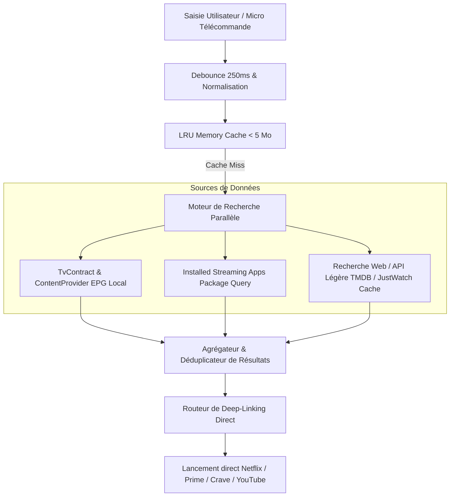

# 🔍 Plan d'Architecture Technique — Moteur de Recherche de Contenu Universel (JD TV)

Ce document décrit l'architecture, l'intégration des flux et la stratégie de déploiement pour le futur moteur de recherche universel multi-plateformes de **JD TV**.

---

## 1. Objectifs & Contraintes Matérielles

- **Cible** : Chromecast with Google TV 4K (`sabrina`), 2 Go RAM physique.
- **Plafond Mémoire Moteur de Recherche** : **< 5 Mo de RAM**.
- **Réactivité D-Pad** : Affichage des résultats en temps réel à 60 fps avec latence de frappe < 80 ms.
- **Zéro Dépendance Lourde** : Pas de Jetpack Compose, pas de backend distant propriétaire lourd. Architecture 100% native Android Views.

---

## 2. Architecture Globale du Moteur de Recherche



---

## 3. Intégration des APIs & Sources de Données

### A. Intégration Native Android TV (`TvContract`)
Android TV expose un Content Provider standardisé pour les chaînes et programmes enregistrés :
- URI : `content://android.media.tv/preview_program` et `content://android.media.tv/program`
- Requête SQL standard :
  ```kotlin
  val projection = arrayOf(
      TvContract.PreviewPrograms._ID,
      TvContract.PreviewPrograms.COLUMN_TITLE,
      TvContract.PreviewPrograms.COLUMN_POSTER_ART_URI,
      TvContract.PreviewPrograms.COLUMN_INTENT_URI,
      TvContract.PreviewPrograms.COLUMN_PACKAGE_NAME
  )
  val cursor = contentResolver.query(
      TvContract.PreviewPrograms.CONTENT_URI,
      projection,
      "${TvContract.PreviewPrograms.COLUMN_TITLE} LIKE ?",
      arrayOf("%$query%"),
      null
  )
  ```
- **Avantage** : Zéro consommation de bande passante réseau, résultats instantanés (< 10 ms).

---

### B. Deep-Linking Direct vers les Plateformes Majeures

Chaque plateforme supporte des Intents explicites ou des schémas d'URI dédiés pour ouvrir la fiche d'un film ou d'une série :

| Plateforme | Schéma URI / Action Intent | Format de routage |
| :--- | :--- | :--- |
| **Netflix** | `http://www.netflix.com/watch/$titleId` | Intent `ACTION_VIEW` vers package `com.netflix.ninja` |
| **Amazon Prime Video** | `https://app.primevideo.com/detail?gti=$gti` | Intent `ACTION_VIEW` vers package `com.amazon.amazonvideo.livingroom` |
| **YouTube** | `https://www.youtube.com/watch?v=$videoId` | Intent `ACTION_VIEW` vers package `com.google.android.youtube.tv` |
| **Disney+** | `disneyplus://play?contentId=$id` | Intent `ACTION_VIEW` vers package `com.disney.disneyplus` |
| **Crave** | `https://www.crave.ca/en/search/$query` | Intent `ACTION_VIEW` vers package `ca.bell.cravetv.androidtv` |
| **Apple TV** | `https://tv.apple.com/movie/$id` | Intent `ACTION_VIEW` vers package `com.apple.atve.androidtv.appletv` |

---

### C. Recherche Web & Métadonnées Légères (Fallback API)
- Utilisation de l'API REST légère **TheMovieDatabase (TMDB)** ou **JustWatch** en lecture seule :
  - Endpoint : `GET https://api.themoviedb.org/3/search/multi?query={query}&language=fr-CA`
  - Les requêtes sont filtrées pour ne rapatrier que les titres, synopsis court et URLs d'affiches 180p compressées WebP.
  - Mise en cache stricte pendant 7 jours en mémoire cache SQLite locale chiffrée.

---

## 4. Stratégie de Performance & Mémoire RAM (< 5 Mo)

1. **LRU Cache en Mémoire** :
   - Capacité maximale : 100 requêtes récentes.
   - Poids moyen d'un objet résultat : 2 Ko -> Empreinte totale < 250 Ko.
2. **Gestion des Images / Vignettes** :
   - Décodage strict au format `Bitmap.Config.RGB_565` (16 bits par pixel au lieu de 32 bits ARGB_8888, division par 2 de la RAM).
   - Recyclage immédiat des Bitmaps lors du défilement dans le `RecyclerView`.
3. **Debouncing D-Pad** :
   - Déclenchement de la recherche 250 ms après la dernière frappe de touche pour ne pas surcharger le processeur Amlogic.

---

## 5. Feuille de Route d'Implémentation (Post-v0.9)

1. **Jalon 1 (v1.0)** : Interface visuelle de recherche modale avec clavier virtuel T9/alphabétique D-pad natif.
2. **Jalon 2 (v1.1)** : Implémentation du `ContentProviderSearcher` pour lire `TvContract` en local.
3. **Jalon 3 (v1.2)** : Intégration de la recherche vocale avec `SpeechRecognizer` via le micro de la télécommande.
4. **Jalon 4 (v1.3)** : Enrichissement par API distante avec logos de disponibilité sur chaque plateforme (ex: "Disponible sur Netflix & Prime").
